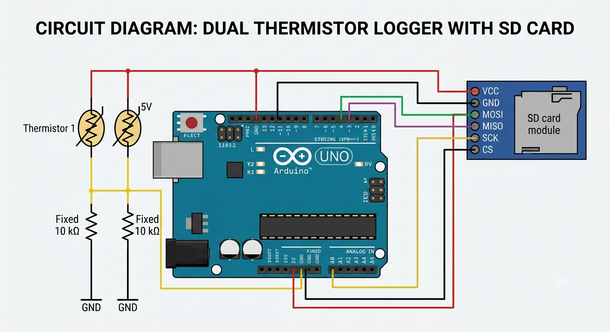

# Arduino-Dual-Thermistor-Logger
Dual thermistor logger using Arduino Uno R3 using 10k thermistors and saving the data into an SD card.
# Dual Thermistor SD Card Logger

## Circuit Diagram

## Pins Used
* Thermistor 1: Pin A1
* Thermistor 2: Pin A4
* SD Card Module: SPI (CS: 10, MOSI: 11, MISO: 12, SCK: 13)
